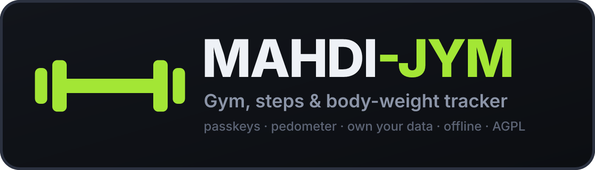
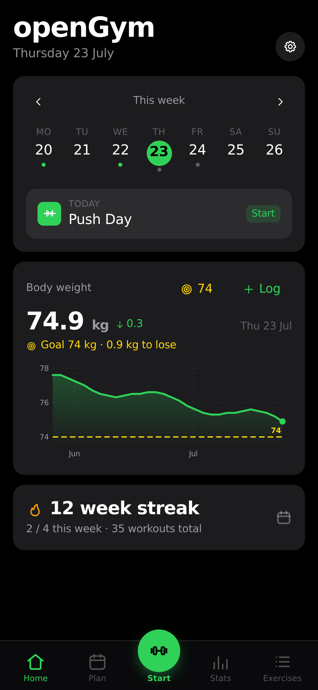
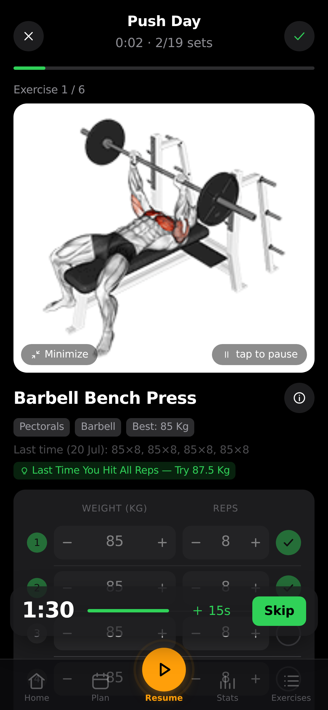
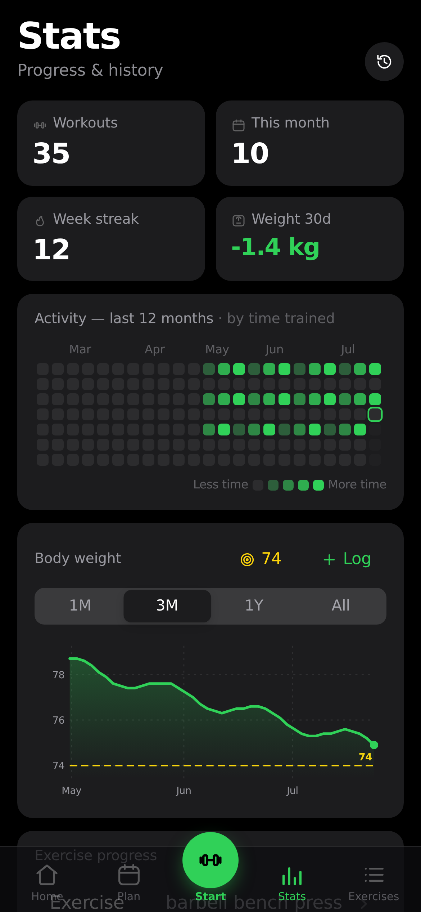

<div align="center">



<br>

**جسمك، خطتك، إرادتك.** — *Your body. Your plan. Your will.*

**A self-hosted gym, step & body-weight tracker you actually own.**

Plan your week, run guided workouts, count your steps, verify every weigh-in — on your phone,
synced across devices, behind your own passkey login. No account on someone else's server,
no subscription, no ads, no tracking. Just `docker compose up`.

<br>

[](LICENSE)


**MAHDI-JYM** · short name **MH-JYM**

</div>

<br>

> ### 🚶 New in 2.0 — walking and verified body weight
>
> MAHDI-JYM is built on [openGym](https://github.com/DuarteSantos8/openGym) (and the
> [AI Coach fork](https://github.com/alexpcosta/openGym)) and keeps its design, its privacy
> rules and its license. 2.0 adds a **pedometer** with speed, distance, calories and a daily
> goal, an **ongoing step notification**, a **haptic tick every 1,000 steps**, a
> **5-second celebration**, **smarter workout reminders** merged with walking, a full
> **body-weight verification** screen, and **Arabic** with a right-to-left layout.
> Everything new runs on the device — no new server, no cloud, no new runtime dependency
> in the web app. See the [changelog](CHANGELOG.md).

<br>

<div align="center">
<table>
<tr>
<td align="center"><br><sub><b>Home</b> — today's workout, steps & weight</sub></td>
<td align="center"><br><sub><b>Guided workout</b> — animated demos & sets</sub></td>
<td align="center"><br><sub><b>Stats</b> — heatmap, charts & PRs</sub></td>
</tr>
</table>
</div>

<div align="center">

### [▶ Try the live demo](https://heroes-jym.com/demo/) · [📱 Download the Android APK](https://github.com/m777m44/Heroes-Jym/releases/latest/download/MAHDI-JYM.apk) · [🌐 heroes-jym.com](https://heroes-jym.com)

No signup, nothing to install — it runs entirely in your browser on example data.<br>
<sub>There's no server behind the demo, so passkey sign-in, sync across devices and the
admin dashboard only exist in a self-hosted instance.</sub>

</div>

## Why

Most workout apps lock your data behind a login on their servers, nag you to upgrade, or
disappear when the startup does. MAHDI-JYM is the opposite: **it runs on your box, your data
stays in a folder you control, and it's yours to fork.** It still feels modern — installable
as a home-screen app, passkey sign-in, offline support, sync across your phone and laptop.

## What's new in 2.0

### 🚶 Pedometer
- **Counts your steps on the device.** In the Android/iOS app it reads the phone's hardware
  step sensor (Android keeps counting while the app sleeps; on iPhone today's total is filled
  in from the motion history). In the browser it uses an on-device accelerometer step
  detector while the page is open.
- **Speed (km/h), distance, calories and active time**, live while you walk. Distance uses a
  stride estimated from your height (or the stride you enter); calories use your latest
  weigh-in. Optional **GPS speed** for outdoor walks — off by default, positions never leave
  the phone and are never stored.
- **A daily step goal you set yourself**, with suggestions based on your own average
  (5,000 · 7,500 · 10,000 · 12,500 · 15,000 · 20,000, a step above your average, or any number). A ring on Home and on the walking
  screen, a 7-day chart, streak, weekly total/average, goal-met days and your best day.

### 🔔 Ongoing step notification
- While counting, a **persistent notification** shows today's steps against your goal, the
  distance and your speed, updated in place — silently. On Android it is a true ongoing
  notification; tapping it opens the walking screen.

### 📳 Haptics every 1,000 steps · 🎉 5-second celebration
- A **triple vibration tick at every 1,000 steps** (a longer pattern at your goal) — Capacitor Haptics in the app, the
  Vibration API in browsers that support it.
- A **5-second celebration** at each milestone and when you reach your goal: an animated
  figure throwing its arms up, a confetti burst in the palette colors and a short chime
  generated with Web Audio (no audio files). Respects *reduced motion*; tap to dismiss.
  Each can be switched off.

### ⏰ Smarter daily workout reminder
- **Merged with walking:** the reminder on a training day also carries your step goal; an
  optional **walk reminder on rest days** fires only while today's goal isn't met.
- **Custom time**, plus a **smart suggestion** — MAHDI-JYM looks at when you usually start
  training and proposes a time half an hour earlier.
- **Follow-up after an hour** if the workout still isn't logged (on by default, switchable).
- Works in both flavors: native local notifications in the mobile app (planned 14 days
  ahead and refreshed each time you open the app), Web Push from your own server in the
  self-hosted web app.

### ⚖️ Verified body weight
- A dedicated **body-weight screen**: current weight, previous weigh-in and the **difference**,
  change since your first weigh-in, the **weekly trend** over the last four weeks and an
  **estimated date** for reaching your goal.
- **Comparison against your target**: start, goal, what's left and a progress bar.
  **BMI** with its category once you enter your height.
- **Verification on entry:** an implausible value (outside the human range, or a jump too big
  for the days since the last weigh-in) asks you to double-check before it's saved.
- **Photo of the scale** to verify a weigh-in. Photos are stored **only on that device**
  (IndexedDB), are never uploaded or synced, and are deleted with the weigh-in.
- A chart with 30 d / 90 d / 1 y / all ranges and the goal line, plus the full history with
  per-entry deltas.

### 🌍 Arabic
- Full Arabic translation of the whole interface with a **right-to-left layout**
  (numbers, charts and number fields stay left-to-right). 13 languages in total.

## Features (from openGym)

- ⚖️ **Body-weight tracking** — interactive chart with a goal line you set, gains/losses colored by whether they move toward it
- 🏋️ **Weekly plan** — a routine per weekday, over a library of **1,324 exercises** (searchable, with animated demos)
- 🗓️ **Reschedule any day** — move a workout to another day without touching your weekly plan
- ▶️ **Guided workouts** — starts today's session, asks your body weight first, pre-fills your weights from last time, rest timer, PR detection
- ☀️ **The screen stays awake while you train** — switchable off in Settings
- 🔗 **Supersets** and ⏱️ **timed exercises** (planks, hangs, carries)
- 📈 **Progression that follows a rule** — linear, **Greyskull LP**, double progression or adding time, per routine or per exercise, with stalls and deloads
- 💪 **Estimated 1RM** with its own progress curve and a calculator
- 🎯 **Effort per set** — RIR or RPE, off by default
- 🏃 **Cardio** — time + speed, not just weight × reps
- 📤 **Share a plan** as a small file, or print it as a clean PDF
- 🔧 **Filter by equipment** · ✨ **your own exercises**
- 🟩 **Activity heatmap** · 💪 **muscle map** (front and back, male or female figure)
- 🔔 **Push notifications** — rest-timer alerts even with the app closed
- 🤖 **AI Coach** (optional) — designs your plan and proposes explained changes from what you log; off until the instance owner enables it, never changes anything without your approval. **[Full guide →](docs/AI_COACH.md)**
- 🔑 **Passkeys, not passwords** — Face ID / Touch ID / fingerprint login; each profile keeps its own data
- 🛠️ **Admin dashboard** (optional) — invite-only signup, per-user history, disable accounts
- 🎨 **Designed, not assembled** — light/dark themes and 8 accent colors, a hand-drawn icon set instead of emoji
- 🌍 **13 languages** — EN, AR, DE, ES, FR, IT, PT, PL, TR, RU, ZH, KO, HI; exercise instructions localized in 10 of them
- 📥 **Bring your history** — import from FitNotes, Strong, Hevy, or body weight from Apple Health
- 📦 **Yours to keep** — one-tap JSON export/import, guest mode, **no telemetry**
- 📱 **Standalone Android app** — no account, no server, data on the phone

## Quick start (self-host)

You need [Docker](https://docs.docker.com/get-docker/) with Compose.

```bash
git clone https://github.com/m777m44/Heroes-Jym
cd Heroes-Jym
cp .env.example .env
docker compose up -d --build
```

Open **http://localhost:8080**, tap **Create profile**, and you're in. First launch downloads
the exercise media (~140 MB) once. You don't need Node or a build step locally — the frontend
builds inside Docker. (`docker compose pull` uses prebuilt images from
`ghcr.io/m777m44/mahdi-jym-*` once the release workflow has published them.)

> Want it reachable from your phone over the internet with passkeys? You'll need an HTTPS
> domain — a two-line change in `.env`. See **[docs/SELF_HOSTING.md](docs/SELF_HOSTING.md)**.
> The step counter in the browser and Web Push both need HTTPS too.

## Mobile app (no server at all)

The same codebase also builds a **standalone mobile app** (Capacitor 7): no account, no sync,
no backend — everything stays on the phone, with the hardware step counter, the ongoing step
notification, native reminders and share-sheet backups.

- **Android:** build the APK yourself — **[docs/MOBILE.md](docs/MOBILE.md)**. Android asks
  for *Physical activity* (steps) and *Notifications* the first time you start counting.
- **iPhone:** build onto your own device from Xcode — see **[docs/MOBILE.md](docs/MOBILE.md)** —
  or self-host and add the PWA to your home screen from Safari (the browser step counter
  then works while the page is open).

## How it works

```
┌─────────────┐        ┌──────────────────────────────┐
│  Your phone │──HTTPS─▶│  web  (nginx)                │
│  / laptop   │        │   ├─ serves the built app    │
└─────────────┘        │   └─ proxies /api ──────────┐│
                       └──────────────────────────────┘│
                                                        ▼
                                        ┌──────────────────────────┐
                                        │  api  (Node + WebAuthn)  │
                                        │   └─ ./data (JSON files) │
                                        └──────────────────────────┘
```

- **frontend/** — React + Vite (React Router + Zustand), built to static files **inside Docker**
- **api/** — Node with no framework, storing everything as plain JSON files under `./data`; it also sends the Web Push reminders (`api/reminders.js`)
- **web/** — a multi-stage image that builds the frontend and serves it with nginx, proxying `/api` so it's all on **one origin** (passkeys require this)

New 2.0 code lives in small, tested modules:

| Module | What it does |
|---|---|
| `frontend/src/lib/stepDetection.js` | Accelerometer step detector (browser fallback) |
| `frontend/src/lib/stepMetrics.js` | Goal, stride, distance, speed, calories, streaks, weekly summary |
| `frontend/src/lib/pedometer.js` · `store/usePedometer.js` | Native sensor / motion source, live session state |
| `frontend/src/lib/stepNotification.js` · `hapticFeedback.js` · `celebrate.js` | Ongoing notification, 1,000-step tick, celebration |
| `frontend/src/lib/dailyReminder.js` · `api/reminders.js` | Reminder planning (mobile) and due-check (server push) |
| `frontend/src/lib/weightTracker.js` · `photoStore.js` | Weigh-in validation, comparison, trend, ETA, BMI; on-device photos |
| `frontend/src/views/Walking.jsx` · `BodyWeight.jsx` | The two new screens |

## Your data

Lives in `./data` on your host: `db.json` (profiles + public passkeys), `state-<user>.json`
(each user's plan, workouts, body weight, steps, settings), and `secret` (the session-cookie
key). **Back up `./data` and you've backed up everything.** Passkey private keys never touch
the server.

Two things deliberately **never** reach the server: **weigh-in photos** (they stay in the
browser/app storage of the device that took them) and **GPS positions** (used live to compute
speed, then discarded). Daily step totals are part of your state, so they sync like the rest.

## Configuration

All via `.env` (see `.env.example`):

| Variable      | What it is                                           | Default                 |
|---------------|------------------------------------------------------|-------------------------|
| `RP_ID`       | Hostname passkeys are bound to                       | `localhost`             |
| `ORIGIN`      | Full URL the app is served from                      | `http://localhost:8080` |
| `WEB_PORT`    | Host port for the web UI                             | `8080`                  |
| `RP_NAME`     | Name shown in the passkey prompt                     | `MAHDI-JYM`             |
| `ADMIN_UIDS`  | User ids that get the admin dashboard (comma-separated) | *(none)*             |
| `INVITE_ONLY` | Require an invite code to create a profile           | *(off)*                 |
| `COACH_DISABLED` | Force the AI Coach off, whatever the admin dashboard says | *(unset)*        |

Push notification keys are generated on first run and saved to `./data/vapid.json` — nothing to set.
The AI Coach needs no `.env` either — see [the AI Coach guide](docs/AI_COACH.md).

## Development

```bash
cd api && npm ci && npm test                  # API tests (node --test)
cd frontend && npm ci && npm test             # Vitest — pure logic + render smoke tests
node scripts/check-locales.mjs                # every locale carries the same keys
npm run dev                                   # Vite dev server
```

The training, walking and weight logic lives in pure functions under `frontend/src/lib/`
with tests next to them. The web app ships no runtime dependencies beyond React, the router
and Zustand; the native features use official/maintained Capacitor plugins that only load in
the mobile build (`@capacitor/haptics`, `@capacitor/local-notifications`,
`@capgo/capacitor-pedometer`).

## Roadmap

- [x] Pedometer with speed, distance, calories, active time and a daily goal
- [x] Ongoing step notification, 1,000-step haptics, 5-second celebration
- [x] Smart workout reminder merged with walking, with follow-up
- [x] Verified body weight — comparison, trend, ETA, BMI, scale photos
- [x] Arabic + right-to-left layout
- [ ] Body measurements (waist, arms…) alongside weight
- [ ] Walking challenges between profiles on the same instance (opt-in, self-hosted only)
- [ ] Health Connect / Apple Health step import
- [ ] More starter plans (upper/lower, full-body, 5×5)

## Credits

MAHDI-JYM is a fork of **[openGym](https://github.com/DuarteSantos8/openGym)** by Duarte
Santos, including the AI Coach from **[alexpcosta/openGym](https://github.com/alexpcosta/openGym)**.
The design, the training engine and most of the app are theirs; thank you. Exercise data from
[hasaneyldrm/exercises-dataset](https://github.com/hasaneyldrm/exercises-dataset) — see
[NOTICE.md](NOTICE.md).

## Contributing

Issues and PRs welcome — see [CONTRIBUTING.md](CONTRIBUTING.md). Please keep to the project's
rules: self-hosted, private by default, offline-capable, no telemetry, and no new runtime
dependency in the web app without a very good reason.

## License

[GNU AGPL v3.0](LICENSE) — free and open source. You can self-host, use, modify and share it;
if you run a modified version as a network service, you must offer that version's source under
the same license.

Exercise images/GIFs are fetched from the upstream dataset and keep their own terms — see [NOTICE.md](NOTICE.md).

---

<div dir="rtl" align="right">

## بالعربية

**MAHDI-JYM** (اختصارًا **MH-JYM**) — *جسمك، خطتك، إرادتك.*

متتبّع للتمارين والخطوات ووزن الجسم تستضيفه بنفسك: بياناتك على خادمك أنت، تسجيل دخول
بمفاتيح المرور، يعمل دون إنترنت، بلا تتبّع ولا اشتراكات.

**الجديد في الإصدار 2.0:**

- 🚶 **عدّاد خطوات** على الجهاز مع السرعة (كم/س) والمسافة والسعرات والوقت النشط وهدف يومي تختاره بنفسك.
- 🔔 **إشعار دائم** بعدد الخطوات أثناء العدّ.
- 📳 **اهتزاز كل 1000 خطوة** و🎉 **احتفال لمدة 5 ثوانٍ** عند كل إنجاز وعند بلوغ الهدف.
- ⏰ **تذكير يومي أذكى** بالتمرين مدمج مع المشي: وقت مخصّص، اقتراح ذكي، وتذكير متابعة بعد ساعة.
- ⚖️ **التحقق من وزن الجسم**: الوزن الحالي والسابق والفرق، المقارنة مع الهدف، الاتجاه الأسبوعي، مؤشر كتلة الجسم، وصورة للميزان تبقى على جهازك فقط.
- 🌍 **واجهة عربية كاملة** باتجاه من اليمين إلى اليسار.

للتشغيل: `docker compose up -d --build` ثم افتح `http://localhost:8080`.
الرخصة: AGPL-3.0.

</div>
